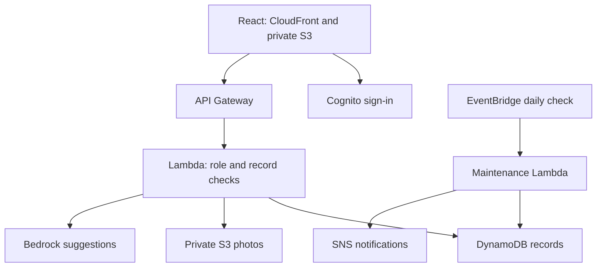

# How SALT fits together

The same frontend can use the local demo or deployed AWS services. Local mode adds simulated sessions and an in-memory store through the Vite development server. AWS mode uses public stack configuration supplied by the person deploying it.

The browser signs in with authorization code and PKCE. It sends an access token to the API. Backend checks use the verified token subject and groups; a role preference in the interface cannot change authorization.

Photo suggestions become an editable draft. Validation rejects unsupported fields and unsafe values. A person reviews the draft before a separate asset-save request. Maintenance suggestions also need review; the app calculates the resulting dates itself.

CloudWatch provides application logs and error alarms. The SAM template describes the services, permissions, storage, and schedule. Tests and infrastructure checks run without deploying the application.

The current list and reporting patterns suit a small class dataset. A larger deployment needs pagination, normalized indexes, and a wider operational review.
